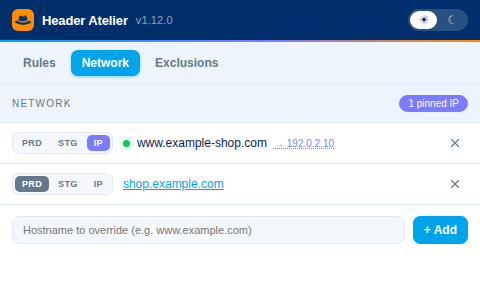

# Header Atelier — native helper

Companion program for the **Header Atelier** Chrome extension (both the internal
and the public build). It lets the extension's **network** tab send a
production hostname to the **Akamai staging network**, or pin it to an IP,
**without admin rights**: no `sudo`, no `/etc/hosts`, no hosts file on Windows.

| | |
|---|---|
| Version | 1.5.1 (`VERSION` in each `native-host.py`) |
| Platforms | macOS (`macos/`), Windows 10/11 (`windows/`) |
| Accepted extensions | `jckelahhlphngdmllbfjmeapdcailnii` (internal), `fmhlfkkokgidhamnfnejlinbjgpmgejh` (public, unpacked), `aecomcdlbbnegglengjcflgdodncmljj` (public, [Chrome Web Store](https://chromewebstore.google.com/detail/header-atelier/aecomcdlbbnegglengjcflgdodncmljj)) |
| Native host name | `com.cinaba.header_atelier` |
| Repository | [cinaba-tools/header-atelier-helper](https://github.com/cinaba-tools/header-atelier-helper) |
| Authors | Chiara Innocentin, Adriano Basile |

`dist/` holds the two ready-to-download zips, `header_atelier_native_host_mac.zip`
(the `macos/` folder) and `header_atelier_native_host_windows.zip` (the `windows/`
folder), rebuilt at every release.

Platform details (files installed, registry keys, troubleshooting) are in
[`macos/README.md`](macos/README.md) and [`windows/README.md`](windows/README.md).

## Guide on Initial Usage

1. Install the **Header Atelier** extension first (either build).
2. Download the zip for your system from `dist/` and unzip it:
   [`header_atelier_native_host_mac.zip`](https://github.com/cinaba-tools/header-atelier-helper/raw/main/dist/header_atelier_native_host_mac.zip) or
   [`header_atelier_native_host_windows.zip`](https://github.com/cinaba-tools/header-atelier-helper/raw/main/dist/header_atelier_native_host_windows.zip).
   (Or clone the repository and use `macos/` or `windows/`.)
3. **macOS**: open Terminal in the unzipped folder and run `./install.sh`
   (**without sudo**). **Windows**: double-click `install.bat`.
4. Quit the browser completely (macOS ⌘Q; Windows menu → *Exit*) and reopen it.
5. Open the extension popup → **Network** tab (*Akamai network* in the internal
   build): the pill reads *production*.
6. Add a hostname served by Akamai, click **STG**, reload the site: the toolbar
   badge turns red **STG** and the row shows the staging edge IP.

## Problem & Solution

The standard way to test a property on the Akamai staging network is to make the
production hostname resolve to a staging edge IP, usually by editing
`/etc/hosts`. That needs admin rights, which managed corporate laptops often do
not grant, and it is easy to forget the entry there.

A browser extension cannot change DNS on its own, so this helper does the part
that needs to run outside the browser, as your own user:

1. Chrome talks to it through **native messaging** (stdin/stdout, JSON frames).
2. For **STG** it follows the hostname's CNAME chain to the Akamai edge hostname,
   derives the staging twin (`foo.edgekey.net` → `foo.edgekey-staging.net`) and
   resolves it; for **IP** it uses the IPv4 or hostname you gave.
3. It runs a small **forward proxy on `127.0.0.1`**. The extension sends only the
   overridden hostnames to it (a PAC script through `chrome.proxy`); the proxy
   opens the connection to the chosen IP.
4. The browser does its own TLS through that tunnel, so the Host header, SNI,
   certificate and cookies stay those of the production hostname. Everything
   else goes direct.

It also answers a read-only **detect** query (is a hostname served by Akamai?)
used by the internal build's badge. DNS is resolved by the system resolver, so
hostnames are never sent to a public DNS service.

## Dependency Installation

| Dependency | macOS | Windows |
|---|---|---|
| Python 3.8+ | `xcode-select --install` (Command Line Tools, no admin) | python.org (tick *Add python.exe to PATH*) or Microsoft Store, no admin |
| `dig` | Included with macOS | Not needed (uses the Windows resolver) |
| A Chromium browser | Chrome, Chromium, Vivaldi, Brave, Edge | Chrome, Edge, Vivaldi, Brave, Chromium |

No third-party Python packages are used.

## Tool Setup

### macOS

```bash
cd ~/Downloads/header_atelier_native_host_mac   # the unzipped folder (or macos/ in a clone)
./install.sh        # never with sudo
```

Installs `native-host.py` into `~/Library/Application Support/header-atelier-helper/`
and a native-messaging manifest into the `NativeMessagingHosts` folder of every
Chromium browser found in your account. Uninstall with `./uninstall.sh`.

### Windows

Extract `header_atelier_native_host_windows.zip` (or use `windows\` in a clone)
and double-click `install.bat`. Installs into `%LOCALAPPDATA%\header-atelier-helper\`
and registers the host under `HKCU\Software\<browser>\NativeMessagingHosts\`.
Uninstall with `uninstall.bat`.

### Updating

Download the new zip from `dist/` and run its installer again (it replaces the files and restarts a
proxy left running by the old one), then restart the browser completely.

Version **1.5.0** renamed the native host to `com.cinaba.header_atelier` and its folder to
`header-atelier-helper`; its installer moves an older install across by itself. Update the
extension first: 1.5.0 needs Header Atelier **1.13.0** or later (public build **1.12.0**).
Version **1.5.1** also accepts the public build installed from the Chrome Web Store.

## Detailed Usage

The helper has no user interface: it is driven by the extension. Messages it
answers (`{"action": …}`):

| Action | Purpose |
|---|---|
| `status` | Version, proxy port and overridden hostnames; restarts the proxy if needed. |
| `set` | Put a hostname on the staging network. |
| `pin` | Pin a hostname to an IPv4 or to a hostname resolved once. |
| `clear` | Back to production for one hostname. |
| `detect` | Read-only: is the hostname served by Akamai (edge CNAME or reverse DNS)? |

Command line (macOS; the Windows script accepts the same arguments):

```bash
python3 "$HOME/Library/Application Support/header-atelier-helper/native-host.py" clear-all       # drop every override
python3 "$HOME/Library/Application Support/header-atelier-helper/native-host.py" restart-daemon  # restart the proxy
```

State and logs: `state.json` and `proxy.log` in the install folder.

The extension refuses helpers older than the version it needs and says so in the
network tab.

## Test Cases

### Automated

```bash
python3 -m unittest discover -s tests -v
```

Runs `tests/test_native_host.py` against **both** helpers (the Windows one runs on
macOS/Linux too, its Windows-only code is behind `os.name == "nt"`). No network,
nothing installed:

| Test | Checks |
|---|---|
| Versions match | macOS and Windows helpers report the same `VERSION`. |
| Staging equivalent | `edgekey.net` / `edgesuite.net` / `akamai.net` map to their `-staging` twins; staging names are kept; non-Akamai names are refused. |
| IPv4 validation | Valid addresses pass; out-of-range, short and non-numeric ones fail. |
| Hostname validation | Real hostnames pass; single labels, spaces and leading dashes fail. |
| Akamai suffixes | Edge hostnames are recognised; `akadns.net` (traffic management) is not. |
| Protocol | A framed message to the real script gets a framed error reply for an invalid hostname and for an unknown action. |

### Manual

| # | Scenario | Steps | Expected |
|---|---|---|---|
| 1 | Install | Run the installer, restart the browser, open the network tab. | Pill reads *production*. |
| 2 | Staging | Add an Akamai-served hostname, **STG**, reload it. | Row shows the staging IP; badge red **STG**; with Enhanced Debug, `Akamai-Property-Info` names the staging version. |
| 3 | Pin | **IP** → type an edge IPv4 → **Pin**, reload. | Row shows that IP; badge periwinkle **IP**. |
| 4 | Back | **PRD**, reload. | No badge; normal DNS. |
| 5 | Not Akamai | **STG** on a hostname not served by Akamai. | Error: it does not resolve through an Akamai edge hostname. |
| 6 | Restart | Override a hostname, restart the computer, reopen the browser. | The override is restored and the site still loads. |
| 7 | Uninstall | Run the uninstaller, restart the browser. | Pill reads *helper not installed*; overrides gone. |

## Contact / Support

- **Authors and maintainers**: Adriano Basile and Chiara Innocentin. Report bugs
  and ask questions in the repository's [issues](https://github.com/cinaba-tools/header-atelier-helper/issues).
- **When reporting a problem**, include the helper version (shown in the
  extension's network tab), the OS, the browser, and `proxy.log` from the
  install folder.

## How-to with screenshots

The helper itself has no window; this is what it enables in the extension's
network tab (a hostname switched to staging, with the staging edge IP):



## License and privacy

[MIT](LICENSE). Privacy policy of the extension and the helper: [PRIVACY.md](PRIVACY.md)
(nothing is collected or sent anywhere).

Header Atelier is a personal project. It is not an official Akamai product and is not
supported or endorsed by Akamai Technologies.
